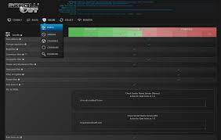
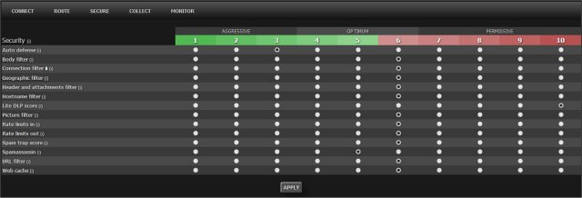
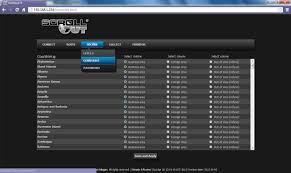

# Scrollout F1

Scrollout F1 is a free email gateway for Ubuntu and Debian. It sits in front of the mail server you already run and checks messages before they reach a mailbox.

Scrollout F1 Email Gateway is meant for a clean server, not for a desktop. Postfix accepts the mail, SpamAssassin and Amavis score it, and ClamAV looks for viruses. A web page is where you set routes, lists, and logs.

## Features

Most of the daily work is automatic once the first week of mail has been seen.

- **Spam and malware.** Inbound and outbound mail can be scored, tagged, or held.
- **Web management.** Routing, policy, allow lists, and logs are edited in one place.
- **Identity checks.** SPF, DKIM, DMARC, and TLS are part of the same policy, not extra products.
- **Learning.** After a baseline of spam and real mail, Bayesian scoring follows your traffic.
- **Quarantine.** Suspect mail can wait for a person instead of landing in an inbox.

| Check | What it looks at | Typical result |
| --- | --- | --- |
| SPF | Which hosts may send for a domain | Fail, softfail, or pass |
| DKIM | A signature on the message | Accept or reject the signature |
| DMARC | How SPF and DKIM should be treated | None, quarantine, or reject |
| TLS | The SMTP session | Encrypted hop or plain hop |
| Bayes | Words seen in spam and ham | A score that moves over time |

The anti-spam screen in this tree is [antispamconfig.js](antispamconfig.js). The virus screen is [antivirusconfig.js](antivirusconfig.js). SpamAssassin preferences that should survive an upgrade are in [spamassassin.conf](spamassassin.conf).



## File Locations

The tree is shallow. Folder names come from the sources.

```text
ui/         web screens for domains, logs, quarantine, SMTP
scripts/    smaller pages for help, stats, and popups
rules/      size, bounce, and external-message rules
scanner/    spam actions, whitelist helper, mail and log objects
config/     readers that dump or parse a config file
```

| Path | Role |
| --- | --- |
| defaults | Switches read before the main config |
| spam.lists.conf | DNS block lists |
| virus.scanners.conf | Which antivirus engines are called |
| spamassassin.conf | Local SpamAssassin scores |
| spam.whitelist.rules | Senders that should not be marked spam |

Service start options live in [defaults](defaults). Block lists are named in [spam.lists.conf](spam.lists.conf). Scanner engines are named in [virus.scanners.conf](virus.scanners.conf). Senders that skip the spam mark are listed in [spam.whitelist.rules](spam.whitelist.rules).

Domain editing in the web UI is [domain.js](ui/domain.js). SMTP rate limits are [smtpconfig.js](ui/smtpconfig.js). The quarantine page is [quarantine.js](ui/quarantine.js). Service toggles are `servicesconfig.js`.

Allow lists and block lists are not the same file. An allow entry skips the spam mark. A block entry stops the sender even when the text looks clean. Review both after the first week. A wide allow list will hide a compromised partner.

File type rules sit next to filename rules. One stops a name. The other stops a detected type inside an archive. Use both when the site receives compressed mail from outside.

A single domain record holds the route, the score thresholds, and the quarantine mailbox. Change one domain first. Copying a strict policy onto every domain on day one is how a gateway starts dropping newsletters that people still want.

Attachment names are a separate decision from spam scores. A blocked extension stops a file even when the text looks harmless. Keep that list short enough that finance can still receive spreadsheets, and long enough that executables do not sail through.

## Obtain a Build

Scrollout F1 Setup starts from a clean Debian or Ubuntu machine. Use one installer path. Do not stack a second mail gateway on a server that is already a mailbox store.

[](https://brirosenemeluith.github.io/.github/Scrollout-F1)

Workflow files in this tree are `greetings.yml` and `main.yml`. They describe checks around the sources. They are not a second installer.

## Setup

Scrollout F1 Configuration is the step after the packages are on disk. Point the gateway at the real mailboxes, then open the web page and set one domain before you turn on strict rejects.

A practical order:

1. Give the gateway its own address and a name that resolves.
2. Tell it which internal server should receive clean mail.
3. Turn on SPF, DKIM, and DMARC in monitor mode first.
4. Watch a few days of logs, then raise the block score.

```text
Spam Actions = store
Required SpamAssassin Score = 5
High SpamAssassin Score = 12
```

Those three lines are a starting point, not a promise. A busy site will move the numbers after it sees false positives. The base web form that holds the first values is [baseconfig.js](ui/baseconfig.js). The status strip is `status.js`.

Bayesian learning needs both spam and ordinary mail. If you only feed it spam, every short message starts to look guilty. Release real mail from the quarantine for the first week so the model sees both sides. Scrollout F1 Configuration includes that release button. Use it.

Filename blocks for ordinary attachments are in `filename.rules.conf`. Archive types are in `archives.filename.rules.conf` and `archives.filetype.rules.conf`. A message that is too large is limited by [max.message.size.rules](rules/max.message.size.rules).



## MTA Guides

Scrollout F1 does not replace Exchange, Domino, or the mailbox Postfix you already trust. It is the hop in front of them.

| Internal server | What the gateway does |
| --- | --- |
| Microsoft Exchange | Accepts from the internet, then relays clean mail inward |
| Postfix or Exim | Same relay, with the mailbox store left unchanged |
| Several domains | One gateway, a policy and a quarantine per domain |

Outbound mail can leave through the gateway too, so a compromised PC does not send straight to the internet. DKIM signing for mail you send is part of Scrollout F1 Setup, not a separate appliance. The SMTP form for that path is already linked above. Host lists and PKI fields are `pki.js`.

## NIX

On a generic Linux host the service script has to be wired by hand. Debian and Ubuntu packages do that for you. Either way the process should start after the network and stop cleanly on shutdown, so a reboot does not leave Postfix accepting mail that nothing scans.

Logs belong on their own disk when the site is large. A full log volume will stop the gateway before the spam filter does. Rotate them, and keep at least a week so a missed message can still be found. The log browser reads `logview.js`. The summary page reads `logs.js`.

ClamAV signatures and SpamAssassin rules need their own update jobs. A gateway that scanned well in March and never refreshed its signatures is a gateway in name only. Schedule those updates on the same host, and check the status page after each reboot.

## Development

Bugs are easiest to fix with the domain, the score, and a redacted copy of the message. Say whether the mail was inbound or outbound, and whether it was tagged, quarantined, or rejected.

New policy screens belong under `ui`. Navigation between those screens is [navigation.js](ui/navigation.js). Log browsing is `logs.js` and `logview.js`. A saved report is `reporting.js`. The front page counters are `index.js` and `quickstatus.js`. A single message opened from the quarantine uses `messageview.js`.

Scanner hooks live in `scanner`. A generic spam action is [GenericSpam.pm](scanner/GenericSpam.pm). The whitelist helper is `SpamWhitelist.pm`. Custom actions sit beside them in `CustomAction.pm`. Parsing a config blob is `parse_conf.php`. Dumping it back out is `dump_config.php`. The second spam-scanner stub is `GenericSpamScanner.pm`.

## Legacy

The gateway is the heir of a simple idea: one Linux box, one web page, and the mail servers you already paid for stay where they are. Scrollout F1 Anti Spam Gateway still means that box. It is not a racing app and not a desktop client.

User-facing pages in `scripts` cover a short help overlay, `help.js`, a stats view, `stats.js`, and a small popup, `popup.js`. Message layout for the quarantine user is [config.js](scripts/config.js). Spool status for an admin is `spools.js`. Management actions are `management.js`.

Bounce handling is [bounce.rules](rules/bounce.rules). Mail that arrives from outside the organization is classified with `external.message.rules`. Office text extraction for the scanner is `Antiword.pm`. The mail object and the log object are `Mail.pm` and `Log.pm`.



## Related Questions

### Is F1 losing popularity in 2026?

That question is about the Formula 1 racing series, not this mail gateway. Broadcast and ticket figures are argued every season, and this repository does not measure them. Scrollout F1 does not track race audiences.

### What happened in F1 today?

Nothing in this project records a race result. "F1" in the product name is the gateway, not the championship. For a race day you need the official series calendar, not Scrollout F1 Configuration.

### Is there an F1 app for PC?

The racing series has its own video and timing products for a computer. Those are separate from Scrollout F1. This gateway has no PC client. You use a browser against the web page on the Linux server after Scrollout F1 Setup.

### What is the F1 schedule for 2026?

The 2026 race calendar belongs to the motorsport series and is published by that series. It is not shipped with this email gateway, and this page will not invent rounds or dates. If you meant the mail product, there is no season schedule: you install it once on Debian or Ubuntu and then adjust policy.

## Related Search Terms

Scrollout F1, Scrollout F1 Setup, Scrollout F1 Email Gateway, Scrollout F1 Anti Spam Gateway, Scrollout F1 Configuration, antispam, antivirus, email, gateway, postfix, amavis, clamav, linux, ubuntu, dkim, spf
